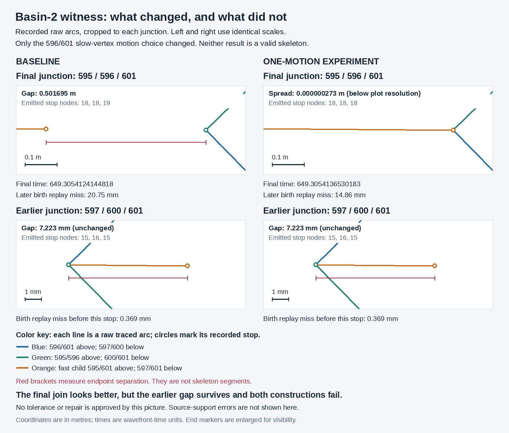

# Basin-2 birth, collapse, and shared-endpoint requirements

**Maintainer-discussion artifact, not a repair or ticket resolution.** The one-change experiment establishes the sensitivity of the final event to the 596/601 slow motion. It does not establish a correct motion policy: it reduces the final separation while making that slow trajectory less accurate against its original supports. Earlier birth/collapse errors and invalid emitted geometry survive.

Decision: [Establish valid birth and collapse rules for the basin-2 witness](https://github.com/atsyplenkov/surfer2-rs/issues/10), under [Chart an evidence-backed repair for projected-basin skeletons](https://github.com/atsyplenkov/surfer2-rs/issues/3). The ticket remains open for live maintainer discussion. This branch must not be merged into master.

## Visual comparison



The picture uses recorded raw arcs and identical left/right scales within each row; x and y scales are equal. Circles mark recorded stops, with enlarged symbols for visibility. Red brackets measure separation and are not skeleton segments. The node labels report emitted identities separately from the plotted raw coordinates. The upper row shows the final gap shrinking; the lower row shows the earlier gap unchanged. This picture does not show source-support residuals or establish correct finite output.

Recreate it with `python3 evidence/issue-10/visualize.py` (Pillow and Liberation Sans fonts required). It reads the preserved traces and comparison only; no additional engine experiment was run.

## Evidence and scope

The starting point is the [preserved ancestry-matched witness](https://github.com/atsyplenkov/surfer2-rs/blob/e3cfa2a65315f01e1f0082a36bd1f03adb858600/evidence/issue-5/ancestry-preserving.md), with its [archives and source-restoration instructions](https://github.com/atsyplenkov/surfer2-rs/blob/e3cfa2a65315f01e1f0082a36bd1f03adb858600/evidence/issue-5/README.md). Original vertices are 594–603, 1143, and 3151. Their binary64 input bits are unchanged. The three closing connectors are synthetic, outside the matched local ancestry; this is not a replacement for the full basin's history.

The source contract and independent-check method come from [Establish upstream successor and collapse-event invariants](https://github.com/atsyplenkov/surfer2-rs/issues/4#issuecomment-6877043273) and [Choose independent checks for event geometry and point-contact topology](https://github.com/atsyplenkov/surfer2-rs/issues/7#issuecomment-6877044243). The source bundle comes from [Make the projected-basin experiments reproducible](https://github.com/atsyplenkov/surfer2-rs/issues/6#issuecomment-6879469382). Their native prerequisite edges were checked; all three are closed. No other issue was worked or closed.

Baseline is Arm A `1b6ed8ea9af51ed9f82f99d56306abc6f6359c7c` plus a read-only observer. Control is `d1a89fd66795f537b034f220ed4f838bd0fdea3b` plus corresponding observers. Neither is a correctness oracle. The baseline rebuild reproduced the historical executable hash before the additional endpoint logging was added. Its new observed JSON is identical to the archived baseline. Control is identical to its archived trace after removing the newly reported empty `interventions` field.

The diagnostic vocabulary is deliberately narrow. A **support** is an original oriented moving line; a **finite edge** also needs active endpoints. A **birth** is a point and time, distinct from the stored absolute-time trajectory origin. A **shared endpoint** is one event incidence used by all relevant arc ends, not a distance comparison. A source-line meeting is a geometric reference conditional on the stated local active-support lifecycle.

## One controlled intervention

[intervention-only.diff](intervention-only.diff) changes one choice in `make_split_successor`, before successor insertion and subsequent event prediction. For the fixed witness's ordered local input-edge IDs 7/2 (original supports 601/596), it replaces the normal-derived velocity by the existing algebraic alternative `intersection_at_time_one - origin_at_time_zero`. It does not replace the origin or supplied birth. The guard is intentionally witness-specific and must not be used as production code or run on unrelated inputs.

```text
baseline:     (-0.9915316883380821, 1.0084083568463786)
intervention: (-0.9915316883707419, 1.0084083573892713)
```

The selected velocity equals control's stored velocity for that pair. No other shared vertex's velocity bits change. Initial states and events through the earlier stop are identical. The input, other motions, birth construction, scheduling, stopping, endpoint rules, and DCEL code are fixed between baseline and intervention. There is no direct event retiming, birth pin, tolerance edit, or validation bypass. Later birth times and topology are allowed to respond to the changed motion.

[Source hashes](source-hashes.json) establish that `src/propagator.rs` is the only differing source file between these two runs. [The observer patch](observer.diff), [complete intervention patch](intervention-with-observer.diff), and source snapshots make the distinction between observer and intervention explicit. `compare.py` checks the observed isolation, and the log records exactly one motion-selection intervention.

## Observed comparison

| Observation | Baseline | Single-motion intervention | Control counterexample |
|---|---:|---:|---:|
| Later split time | 649.3052873722798 | 649.3052872843521 | 649.3052872379936 |
| 595/601 child's birth replay miss, m | 0.02075466918 | 0.01486234055 | 0.03364081385 |
| Final triangle time | 649.3054124144818 | 649.3054136530183 | 649.3054136530183 |
| Final three-vertex separation, m | 0.50169532046 | 0.000000272877738 | 0.000000272877738 |
| Emitted nodes for the three final traced arcs | 18, 18, 19 | 18, 18, 18 | 16, 16, 16 |
| Public construction / graph result | DCEL error | DCEL error | Two coordinate components |

Node numbers are local observation labels, not cross-run identities. Original support pairs identify the compared arcs. Raw records, endpoint mappings, all watched halfedges and stored/exported segments are in the three `.json`/`.log` pairs; [comparison.json](comparison.json) collects the final arcs and relevant face geometry.

The existing scheduler's final x-quotient predictions respond as follows:

| Original support | Baseline prediction | Intervention prediction |
|---|---:|---:|
| 596 | 649.3054124144818 | 649.3054136718612 |
| 595 | 649.3054136530183 | 649.3054136530183 |
| 601 | 649.3054136530184 | 649.3054136530183 |

It still chooses the minimum. Baseline's support-596 relative x speed is only about 0.0168653642; an approximately 2.12e-8 m change in the slow vertex's x motion at the event is enough to shift this quotient by about 1.26e-6 time units. The fast vertex moves about 405056 m per time unit. The isolated change therefore confirms a causal sensitivity of this witness's scheduling and final separation to that motion choice. It does not show that subtraction is the better formula.

In fact, the reference calculations show the opposite locally: at the final event, baseline's slow trajectory differs from its original-support intersection by about 1.1e-11 m in x and -1.79e-10 m in y. With the intervention, those differences become about -2.12e-8 m and +3.52e-7 m. The fast trajectory remains about **4.160 mm wrong in x against its own original-support intersection** at either run's selected time. Small mutual separation is therefore insufficient evidence of correct source geometry.

## Earlier chain and numerical bounds

[The detailed calculation report](calculations/REPORT.md), [certificate](calculations/certificate.json), and [script](calculations/certify_witness.py) distinguish exact input predicates, enclosed source constructions, stored-motion error, and final evaluation rounding. They use the inherited rational-interval functions with square roots enclosed by exact integer squaring on a 2^-192 grid. Decimal interval endpoints are rounded outward. These are witness-specific diagnostic bounds, not a production tolerance.

The relevant source model uses `a*x + b*y = c + length*t`, with exact dyadic `a`, `b`, and `c` from the original endpoints and an enclosed square root for `length`. Pair intersections and triple meetings then use interval linear solves. Nonzero determinants are checked, including the poorly conditioned finite pairs; poor conditioning is not infinite speed.

The earliest demonstrated non-co-arrival in this witness's observed event chain is already its first constraint collapse, at `185.51628709685298`, on the original 597/598/599 chain. The two stopped endpoints are about 3.90224e-7 m apart. Their exact stored-motion y separation is about 3.90122e-7 m, while their individual final evaluation errors are below 1e-10 m in y. This is not an artifact of the final `origin + time*velocity` rounding. The source meeting is enclosed in `[185.51628728706785946041, 185.51628728706785946042]`, about 190.215e-9 wavefront-time units later. This identifies an earlier numerical co-arrival defect, not a globally first invalid event in the original basin, nor proof that this small first mismatch alone causes the later failures.

Its first 599/597 successor makes the conditioning problem concrete. The rounded birth replay misses by only about 4.075 nm, but the exact stored-motion x replay misses by about 96.349 nm; the last floating evaluation hides much of that difference. The recorded birth is about 385.971 nm off source support 597. At the recorded time, the ill-conditioned original-support intersection differs from that birth by about 1.177 m in x. This is a conditional source construction at a time before the exact source event, not a claim that a physical child should already occupy that extrapolated point. Small rounded replay alone is an inadequate birth-consistency check.

The larger early inconsistency is already visible at the split preceding the 7.2 mm stop:

| Original-support construction | Enclosed time |
|---|---|
| Parent 597/596 hits support 601 | [371.02917296181096895215, 371.02917296181096895216] |
| Supports 597/600/601 meet | [371.02917296312872066359, 371.02917296312872066360] |
| Parent 594/595 hits support 601 | [649.30528733131290608687, 649.30528733131290608688] |
| Supports 595/596/601 meet | [649.30541366328843704446, 649.30541366328843704447] |

The first split's finite-hit fraction, measured from the 601/600 endpoint toward 601/602, is enclosed in `[0.00000146593426536185, 0.00000146593426536186]`. Its valid source-model lifetime before the nearby triple meeting is only about **1.318e-9 wavefront-time units**. Baseline records that split at `371.0291729650514`, after the source triple meeting, and creates a 597/601 successor with a **0.368965 mm birth replay miss**. It then stops the triangle at `371.02917302656596`, about 63.437e-9 wavefront-time units after the source meeting, with a **7.223155 mm separation**. The fast vertex's final expression-rounding error in x is only about 2.70e-9 m; its stored-motion/source-motion x difference at that time is about 9.15e-10 m. The millimetre separation is not explained by that final evaluation rounding.

The later split has a source-model finite-hit fraction `[0.49999885705603042819, 0.49999885705603042820]`. Baseline's supplied birth is 40.967e-9 wavefront-time units late relative to that source event. The 595/601 successor's stored motion misses the recorded birth by 20.755 mm; its x replay-rounding contribution is about 9.65e-9 m. At that observed birth time, even the original-support intersection differs from the supplied birth by about 16.594 mm in x. Thus simply forcing the trajectory through the supplied birth would not establish both support incidence and valid event timing.

The local active-support checks use [active.json](active.json): actual live triangles, non-dead edge records, endpoints, and vertex states before each of the first eight events. Removing these observation-only fields reproduces baseline JSON exactly. The certificate also checks local source-model ordering, finite fractions, and edge orientation signs. These checks constrain the necessary local lifecycle; they do not independently replay the whole finite wavefront or certify every competing event. The detailed report states those limits. The source-model 1.318e-9 wavefront-time-unit lifetime must not be replaced by an arbitrary same-time tolerance.

## From stops to face geometry

At the final baseline stop, the 596/601 and 595/596 traces share emitted node 18; the 595/601 trace ends at node 19, about half a metre away. The original source-601 face has no root. Source 595 already contains an `InfinityChord` between these finite nodes. That chord is not a demonstrated missing skeleton ridge.

In the intervention, the unchanged endpoint policy connects all three stop keys to node 18, and the source-601 face gets a cycle with the final arcs meeting at that node. This is a downstream response, not an independent geometry check. The source-595 chord disappears, but the earlier 597/600/601 stop still has nodes 15/16, and the source-597 face retains an `InfinityChord` across its 7.223 mm gap. Source 600 retains a separate roughly 0.150 mm chord between an early split birth and a later stop. Construction now fails on that source-600 face because a halfedge is unreachable from its root. No success is claimed from moving the validation error.

Control passes bounded-face construction but returns 19 finite segments, 21 coordinate nodes, and two components. It has different preceding history and policies, so it is not the isolated intervention. Its larger birth miss, small final separation, shared final node, retained chord on source 597, and disconnected export jointly rule out using control, small separation, or bounded-cycle success as correctness criteria.

## Requirements proposed for maintainer acceptance

1. **Birth consistency is a coupled obligation.** For a finite successor, its point/time, active ordered supports, and trajectory must describe the same incidence. Check replay and both moving-support equations with conditioning-aware numerical bounds. Preserve a distinct finite lifetime when the source events are distinct. A pin to an inconsistent supplied birth, a speed cap, or generic freezing does not meet this requirement.
2. **Collapse requires geometric co-arrival.** An edge collapse must have a planar meeting; a three-constraint triangle may stop all three vertices only when their motions and the original-support event are mutually consistent. The minimum of disagreeing x-quotient times is insufficient. Bounds must include motion construction, event-time construction, time sensitivity, and final evaluation. Ambiguous order requires stronger calculation or an explicit unresolved condition, not an enlarged joining tolerance.
3. **One valid event must have one shared endpoint identity.** Once event membership and geometry are established, all incident arc ends must use the same event node and exported coordinate. Conversely, close but distinct births/stops must remain distinct. Coordinate closeness or equal rounded times cannot supply that membership proof. Face ownership and trace coverage must survive emission; a chord, duplicate deletion, or root alone cannot establish the correct finite face boundary.
4. **Acceptance must keep independent geometry and topology checks.** Retain baseline and control as negative cases. Require source-support consistency, the justified finite births and lifetimes, appropriate co-arrival, shared identities, complete affected arcs, valid face geometry, and the public finite coordinate graph. Do not choose an error allowance from whichever value closes the face.

These requirements are supported without selecting a production arithmetic algorithm, proving every full-basin event, or resolving the broader residual investigation. They leave the implementation-wide error budget and proof of complete basin output to the later repair design. If maintainer acceptance instead requires an unconditional exact finite-wavefront history for this witness, the missing evidence is a bounded independent lifecycle/order replay through the tightly spaced predecessor events; final face closure cannot provide it.

## Reproduce and inspect

The retained source bundle is [revisions.bundle](https://github.com/atsyplenkov/surfer2-rs/blob/e3cfa2a65315f01e1f0082a36bd1f03adb858600/evidence/issue-6/sources/revisions.bundle). Download it as a raw file, or use the preserved local copy. Run:

```sh
bash evidence/issue-10/replay.sh /absolute/path/to/revisions.bundle
python3 evidence/issue-10/compare.py
```

`replay.sh` creates fresh scratch clones, applies the observer and single intervention separately, builds with `cargo build --release --offline --locked`, compares the observed JSON and logs, and runs the expected-red check. It also rebuilds the active-state observer. Offline dependencies must already be cached. The diagnostic driver exits zero when it returns an error as JSON; `red.sh` supplies the failing public construction/connectivity assertion.

For source-line calculations, first restore the two retained evidence archives according to their linked README, then run:

```sh
python3 evidence/issue-10/calculations/certify_witness.py \
  --restored /absolute/path/to/restored-issue-5-checkout \
  --traces /absolute/path/to/evidence/issue-10 > /tmp/issue10-certificate.json
cmp /tmp/issue10-certificate.json evidence/issue-10/calculations/certificate.json
```

The script prints its certificate without modifying retained observations. The inherited polygon-predicate and formula checks remain identified in the starting evidence. No input coordinate or golden value was changed.

Fresh checks passed: three release builds; repeat trace/log equality; historical baseline/control comparison as qualified above; all-three source-bundle restoration; single-motion isolation; active-observer equivalence; and rational-interval calculations. All three construction/connectivity checks remain **red, exit 1**, as expected. The release observer executes in about 6 ms per witness. [restoration.log](restoration.log), [replay-verification.json](replay-verification.json), build logs, source hashes, and the manifest record commands, profile, toolchain, and identities.

A separate review agent did not return a verdict because its provider reached a usage limit. No completed independent review is claimed; the main session checked the intervention diff, source isolation, replay, endpoint mappings, calculations, and report links.

Skipped: debug profile, full original basin propagation, river/lake regressions, full suite, clippy, whole-codebase formatting, an external exact skeleton engine, and complete independent finite-wavefront replay. They are not claimed as passed. This is a bounded diagnostic decision, not production validation. The main checkout and existing diagnostic worktrees were left unchanged; no PR or production repair was made.
